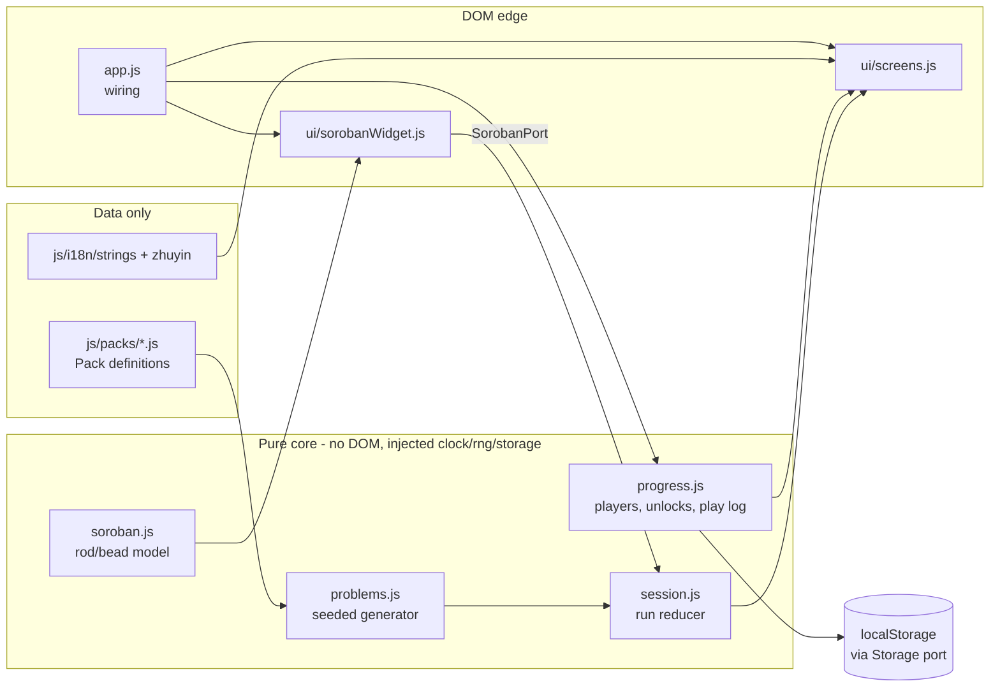

# Design: Abacus Quest Kids — soroban challenge game

**Date:** 2026-10-31
**Status:** proposed
**Stack:** browser-only static site — ES modules + JSDoc types checked by `tsc --checkJs` (strict), Node ≥ 22 built-in test runner, Playwright for e2e, GitHub Actions → GitHub Pages. No server, no protobuf, no Docker (see Deviations).

## Problem

A kid who already practices 珠算 needs a game that makes add/subtract
drills feel like Minecraft mining, with the answer read from real bead
state. PRD: `docs/product/abacus-challenge.md` (7 P0 stories). The product
is a client-only static page like the sibling Code Quest Kids, so the design
is about a **pure, testable core** with a thin DOM layer, and about putting
real type gates on a build-less codebase.

## Design

Single deployable: a static site. Pure logic in `js/core/` (no DOM, no
`window`, no `Date.now()`, no `localStorage` — all injected), DOM in
`js/ui/`, data in `js/packs/` and `js/i18n/`.

**Components** (each: one job)

- `core/soroban.js` — rod/bead model. A rod is `{heaven: 0|1, earth: 0..4}`,
  value `5*heaven + earth`. `tapEarth(rod, k)` has real soroban semantics:
  tapping earth bead *k* (1 = nearest the beam) toward the beam moves *k*
  and all beads between it and the beam; tapping a bead already up moves it
  and the ones beyond it away. `tapHeaven` toggles. `value(rods)`,
  `fromNumber(n, rodCount)`.
- `core/problems.js` — seeded generator: `generate(spec, rng) → Problem[]`.
  Classifies each step as `plain | complement5 | complement10 | borrow`
  from per-digit arithmetic and only emits steps the pack's `allow` list
  permits.
- `core/session.js` — a reducer `(state, event) → state` for one run:
  hearts, XP, streak, per-problem elapsed ms, fuse timeout. Events:
  `submit(valueFromRods, nowMs)`, `tick(nowMs)`, `skip`. Pure; the caller
  supplies time.
- `core/progress.js` — players, per-pack stars, unlock rule, play log
  (`{packId, correct, ms, at}`), weekly aggregates for the parent screen.
  Talks to a `StoragePort` (`get/set` of strings), never `localStorage`
  directly.
- `ui/sorobanWidget.js` — renders the Minecraft-styled rods (DOM + CSS, no
  canvas, ≥44 px bead targets), implements `SorobanPort`
  (`getValue(): number`, `setValue(n)`, `clear()`, `onChange(cb)`).
- `ui/screens.js` + `app.js` — map/pack grid, level screen, results,
  parent progress screen, language switch. Only place that touches the DOM
  besides the widget.
- `i18n/strings.js` + `i18n/zhuyin.js` — EN and zh-TW tables; zhuyin dict
  is a from-scratch per-char table scoped to this app's vocabulary (the
  sibling's table is seeded from, but the coverage test is the authority).
- `packs/*.js` — **data only**, one per depth level (Surface, Cave, Deep
  Mine, Nether, End). Validated by `parsePack` at load.

Reuse from `code-quest-kids`: copy the zhuyin approach, the players/
leaderboard idea, the Pages `deploy.yml`, and the visual conventions. Do
**not** copy its `window.*` IIFE globals — modules are what make the core
testable in Node.

## Language choices

| Component | Language | Why this one | Type gate in CI |
|-----------|----------|--------------|-----------------|
| `core/*` | JavaScript (ESM) + JSDoc types | Runs in the browser with no build step (PRD: zero-build); JSDoc gives full type checking without a compile | `tsc --noEmit --checkJs --strict` (+ `noUncheckedIndexedAccess`) |
| `ui/*`, `app.js` | JavaScript (ESM) + JSDoc types | Same; DOM edge only | same `tsc` run |
| `packs/*`, `i18n/*` | JavaScript data modules | Data authored by hand; schema-checked at test time | `tsc` + `parsePack` test over every pack |
| Tests, tooling | JavaScript (Node) | Node's built-in `node:test`; no framework dependency | `tsc` covers test files too |
| e2e | JavaScript + Playwright (dev-only) | Needed for a real browser at phone viewport | n/a (dev dependency only) |

One language family, one `tsconfig.json`, zero runtime dependencies. The
browser ships exactly what's in the repo.

## Contracts

There is no network boundary, so contracts are in-process types and the
persisted-data schema. All live in `js/types.d.ts` (single source of truth);
nothing is described twice.

- **`Pack` (schema v1)** — `{schemaVersion:1, id, depth, titleKey, mode:
  'set'|'addsub'|'timer', rods, allow:[...stepKinds], digits, count, seed?,
  fuseMs?, starRules, unlockRequires:{packId, stars}}`. `parsePack(unknown)`
  validates and returns `Pack | Error`.
- **`Problem`** — `{start:number, op:'+'|'-', operand:number,
  target:number, kind:StepKind}`; invariants `0 ≤ target < 10^rods`.
- **`SorobanPort`** — the seam between pure session logic and the DOM
  widget (above). Tests use an in-memory fake.
- **`StoragePort`** — `{get(key): string|null, set(key, value): void}`.
- **Persisted state (`aqk.v1`)** — `{version:1, lang, currentPlayer,
  players: Record<name, PlayerState>}`. Every read goes through
  `parseState(unknown)` — **parse, never cast**; a corrupt or older blob
  falls back to defaults (and a `migrate` function handles `version`
  bumps). The hand-written parser stands in for zod/Pydantic because there
  are no runtime deps by design.
- **`PlayLogEntry`** — `{packId, correct:boolean, ms:number, at:number}`;
  holds no personal data beyond the player's chosen nickname.

## Test strategy

Tests are named before implementation (each is a first red test in its
slice). All unit tests are table-driven `node:test`, no DOM.

**`core/soroban.js`**
- `tapEarth` table: (state, tapped bead) → state, covering all 4 beads in
  both directions, and bead-between-moves semantics.
- `value` / `fromNumber` round-trip for 0..99999 on 5 rods.
- Property: any value 0–9 on a rod is reachable by some tap sequence.

**`core/problems.js`**
- Classifier table: `(start, operand, op) → kind` (e.g. 3+4 = `complement5`,
  7+5 = `complement10`, 12−5 = `borrow`, 2+3 = `plain`).
- Same seed → same problems (determinism); different seed → different.
- Invariants over 1000 generated steps per pack: result in
  `[0, 10^rods)`, kind ∈ `allow`, operand digit count matches spec.
- This **is** the "solvability check" in PRD Story 3 — a 1+4 rod can show
  every digit, so the real risks are negative results, rod overflow and
  mislabelled carry kinds. The test pins exactly those; it runs in CI.

**`core/session.js`** — reducer table: correct/incorrect/timeout events
× hearts/XP/streak; zero hearts → `over`; bonus XP strictly monotone in
speed; stars from `starRules`.

**`core/progress.js`** — with an in-memory `StoragePort`: add/switch player,
star save keeps best, unlock gate, weekly aggregates from a fixed log,
`parseState` rejects/repairs garbage (table of malformed blobs).

**i18n** — coverage test: every Han character in zh-TW strings has a
zhuyin entry; key parity between EN and zh-TW tables.

**Packs** — every file in `js/packs/` passes `parsePack`; every `unlockRequires`
refers to an existing pack; no unlock cycle.

**Contract tests** — `SorobanPort` is exercised against both the fake and
the real widget (under a minimal DOM stub in Node) by the same shared test
table, so the fake can't drift from the widget.

**e2e (happy path, `/qa-e2e-test`)** — Playwright at 390×844: open page →
pick player → set-the-number level → add/sub level solved by bead taps →
Creeper level → results with stars → reload → progress persisted → switch
to zh-TW and see 注音. Real browser, real `localStorage`; nothing mocked.

**Type gate** — `tsc` strict is a required CI job, failing the build the
same as a red test.

## Delivery slices

CI lanes: `typecheck`, `unit` (`node --test`), `e2e` (Playwright), and the
Pages deploy on `master`.

0. **S0 — Contracts + CI + deploy skeleton (contract first).**
   `types.d.ts`, `parsePack`/`parseState` with stubs, `SorobanPort` +
   fake, empty `index.html`, `tsconfig` strict, `typecheck`+`unit` jobs,
   `deploy.yml`, one-time Pages enablement, README, MIT. *Accept:* CI green
   on `master`, live URL serves the placeholder page. Merges first. (Story 7)
1. **S1 — Walking skeleton: playable soroban + one hardcoded
   set-the-number level.** `core/soroban.js` real, widget, one level
   wired. *Accept:* on the live URL a phone-size viewport can set 7 and
   see "done"; `soroban` tests green. (Story 1, thin Story 2)
2. **S2 — Problem generator.** `core/problems.js` + invariants tests.
   *Accept:* tests above green; no UI. (Story 3 core)
3. **S3 — i18n + zhuyin + coverage test + language switch.** (Story 6)
4. **S4 — Progress store.** players, stars, unlock rule, play log,
   `parseState`. No UI beyond a player picker stub. (Story 5 persistence)
5. **S5 — Add/subtract mines.** `core/session.js` reducer, level screen
   against `SorobanPort`, Mine! submit, hearts, XP. Built against the
   fake port + S0 generator stub; wired to the real widget/generator as
   S1/S2 merge. *Accept:* reducer tests green; a pack of add/sub problems
   is playable end-to-end. (Story 3)
6. **S6 — Set-the-number packs.** Pack data for 1-digit → 4-digit. (Story 2)
7. **S7 — Timer challenges (Phase 1).** `core/fuse.js` + widget: Start!
   3-2-1 kick-off, Creeper fuse, stopwatch, speed bonus, best time. Built
   against the S0 contracts and plugs into S5's `tick`/`submit` events, so
   it is parallel to S5, not behind it. (Story 4)
8. **S8 — Rewards, unlocks, map screen, parent progress screen.** On S4+S5.
   (Story 5 UI)
9. **S9 — Pixel theme + original art.** Blocks, font, backgrounds; parallel
   to everything, no logic. (Story 1/theme)
10. **S10 — e2e happy path + README screenshots.** After the rest.

**Dependency graph**: after S0, slices **S1, S2, S3, S4, S5, S9 run in
parallel** (S5 uses the fake port and stub generator at the seam). Chains
that remain, each edge real:
`S0 → S5 → S8` (rewards read session results; also needs S4),
`S1 → S6` (levels need the widget). Longest chain: three links.
S10 depends on all and is the integration gate.

## Deviations from the default stack

| Deviation | Justification | Containment |
|-----------|---------------|-------------|
| No protobuf/gRPC/grpc-gateway, no Go/Python | There is no server and no network call; PRD forbids backend and accounts. A proto would describe nothing. | If a sync/leaderboard backend is ever added, it is a new Go service with a proto contract, and `types.d.ts` types become generated from it. |
| Plain JS + JSDoc instead of TypeScript sources | PRD and sibling convention are zero-build: files served exactly as written, no compile step in the deploy. Typing is not given up: `tsc --checkJs --strict` is a required CI gate. | One `tsconfig`. If bundling is ever needed, files rename `.js`→`.ts` with no logic change. |
| No Next.js/React/Tailwind | Static, offline-capable page with ~10 screens; a framework needs a build and adds a lockfile + patch cadence for no gain. Tailwind needs a build; the pixel theme is hand-written CSS with design tokens. | CSS in `css/`; no runtime dependencies. |
| No Docker | Nothing to containerize — the artifact is static files. `npx serve .` or `python3 -m http.server` for local dev. | Playwright runs in the CI runner. |
| Hand-written parsers instead of zod | Zero runtime deps; two schemas only (`Pack`, `State`). | Parsers live in one file with table tests. |

## Rejected alternatives

- **Next.js + React static export.** Matches the default stack, but turns a
  ~10-screen kids' page into a build pipeline with a lockfile and framework
  upgrades, and breaks "zero-build". The rod/bead model is the interesting
  part, and it is framework-free either way.
- **Copy Code Quest Kids' `window.*` IIFE structure.** Fastest to start, but
  the engine could not be unit-tested in Node without a DOM, and there is
  no type checking. ES modules + JSDoc keep the same zero-build deploy and
  make the core testable.
- **Canvas-rendered soroban.** Good for animation, but loses accessible
  hit targets and free DOM events/touch handling; DOM beads are enough for
  the PRD.

## What changes at 10x

Players or packs 10×: packs lazy-load via dynamic `import()`. Multi-device
sync or shared leaderboards: a Go service with a proto contract (see
Deviations). More than ~5 depth packs of content: a pack authoring tool
(PRD P2 teacher editor) that emits `Pack` v1 JSON validated by `parsePack`.
